<p align="center">
  
</p>

<p align="center">
  <b>Zarcade</b> is a boardwalk arcade of small browser games for all ages.<br>
  No installs, no ads, no accounts. Just plain HTML, CSS and JavaScript, one cabinet per folder.
</p>

<p align="center">
  🪙 <a href="#-insert-coin">Insert coin</a> ·
  🎮 <a href="#-the-cabinets">The cabinets</a> ·
  🦊 <a href="#-meet-the-regulars">Meet the regulars</a> ·
  🌟 <a href="#-psst">Psst…</a> ·
  🔧 <a href="#-behind-the-counter">Behind the counter</a>
</p>

---

## 🪙 Insert coin

```sh
npm run serve      # then open http://localhost:8000
```

That's the whole setup: no build step and no dependencies. The page you land on
is **Starlight Arcade**, the game picker. Choose a cabinet with the mouse, a tap,
the arrow keys or a gamepad, then press **Play**. Every game has a `← Arcade`
link on its title screen and a *Back to arcade* button in its pause menu, so
there is always a way home.

On a phone or tablet on the same Wi-Fi, open `http://<your-computer's-IP>:8000`.
The games are built for touch and for phones held either way up.

## 🎮 The cabinets

Every game in the arcade, shelf by shelf. Click a cover to open its folder;
each game has its own README with controls, tips and debug switches.

<!-- cabinets:start — generated by `npm run readme` from arcade/games.js; edit the manifest, not this block -->

### 🗺️ Action & Adventure

<table>
<tr>
<td align="center" valign="top" width="25%"><a href="games/neon-nighthawk/">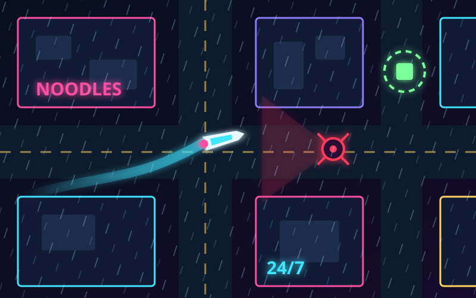</a><br><b><a href="games/neon-nighthawk/">Neon Nighthawk</a></b><br><sub>Deliver after dark. Light the city back up.</sub></td>
<td align="center" valign="top" width="25%"><a href="games/starhopper/">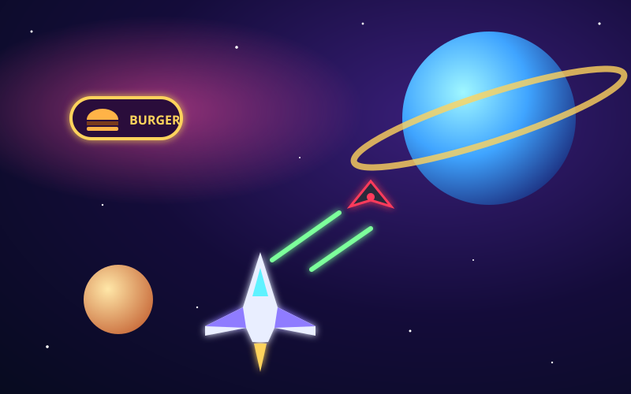</a><br><b><a href="games/starhopper/">Starhopper</a></b><br><sub>Hop across an endless galaxy.</sub></td>
<td align="center" valign="top" width="25%"><a href="games/pips-peak/">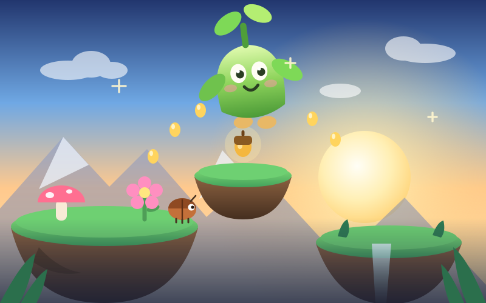</a><br><b><a href="games/pips-peak/">Pip's Peak</a></b><br><sub>A sprout's bouncy climb to the sunrise.</sub></td>
<td align="center" valign="top" width="25%"><a href="games/jungle-blaster/">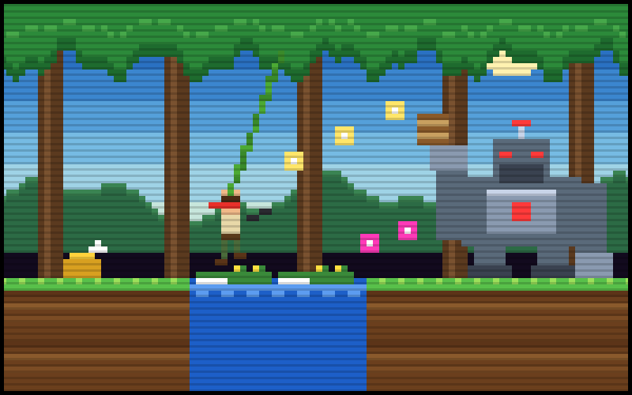</a><br><b><a href="games/jungle-blaster/">Jungle Blaster 2600</a></b><br><sub>Swing, hop and blast through a retro jungle.</sub></td>
</tr>
<tr>
<td align="center" valign="top" width="25%"><a href="games/lanternwood/">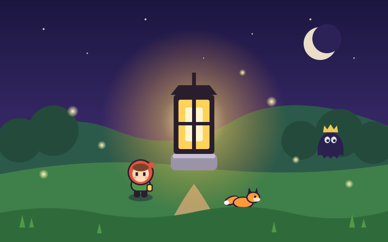</a><br><b><a href="games/lanternwood/">Lanternwood</a></b><br><sub>Relight the Great Lantern with a fox friend.</sub></td>
<td align="center" valign="top" width="25%"><a href="games/dino-dash/">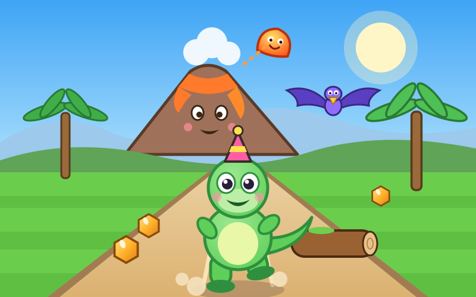</a><br><b><a href="games/dino-dash/">Dino Dash</a></b><br><sub>Run, little dino! Dodge, jump, roll, grab amber.</sub></td>
<td align="center" valign="top" width="25%"><a href="games/crayon-quest/">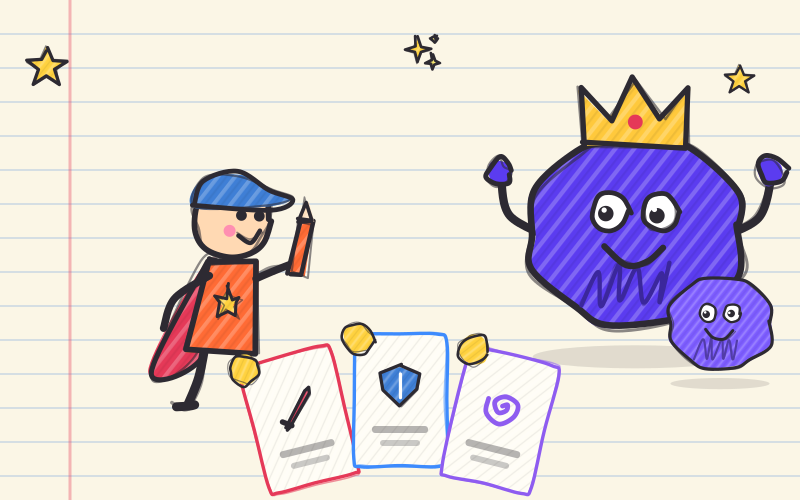</a><br><b><a href="games/crayon-quest/">Crayon Quest</a></b><br><sub>Doodle deckbuilder: climb the sketchbook tower.</sub></td>
<td align="center" valign="top" width="25%"><a href="games/deep-dive/">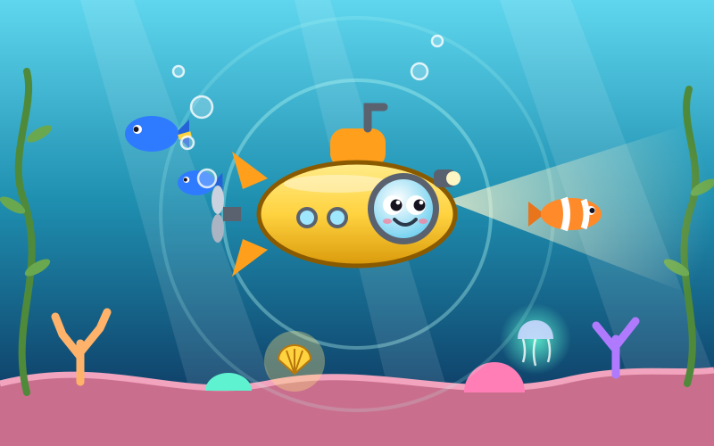</a><br><b><a href="games/deep-dive/">Deep Dive</a></b><br><sub>Sub adventure: sonar, sea creatures, the deep unknown.</sub></td>
</tr>
<tr>
<td align="center" valign="top" width="25%"><a href="games/mole-miner/">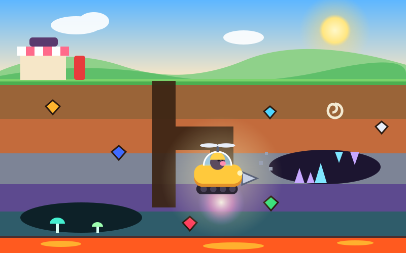</a><br><b><a href="games/mole-miner/">Mole Miner</a></b><br><sub>Drill down with Momo the mole to the Ancient Core.</sub></td>
</tr>
</table>

### 🏁 Racing

<table>
<tr>
<td align="center" valign="top" width="25%"><a href="games/sundown-rally/">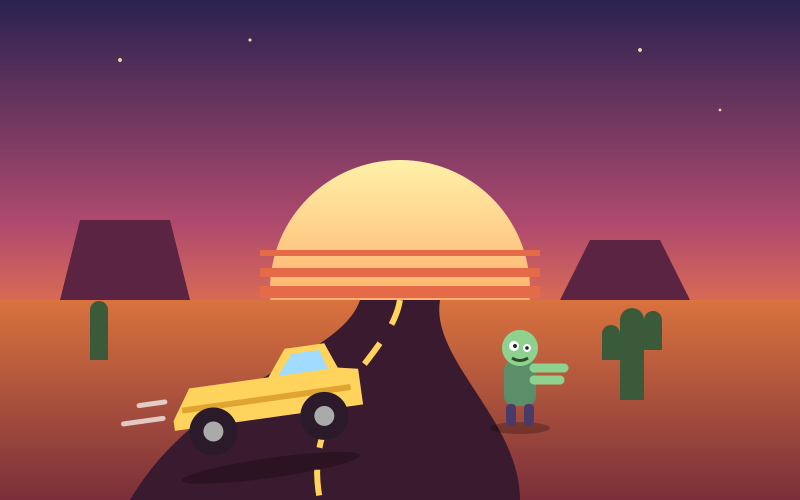</a><br><b><a href="games/sundown-rally/">Sundown Rally</a></b><br><sub>Race the sunset. Outrun the undead.</sub></td>
<td align="center" valign="top" width="25%"><a href="games/globe-gp/">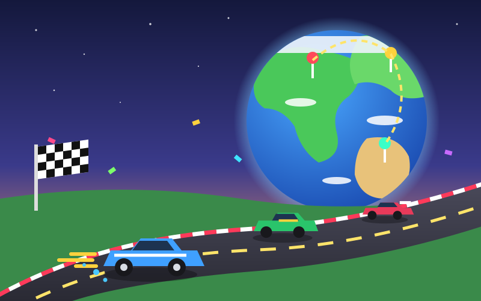</a><br><b><a href="games/globe-gp/">Globe Grand Prix</a></b><br><sub>Race six rivals around the world.</sub></td>
<td align="center" valign="top" width="25%"><a href="games/pocket-kart/">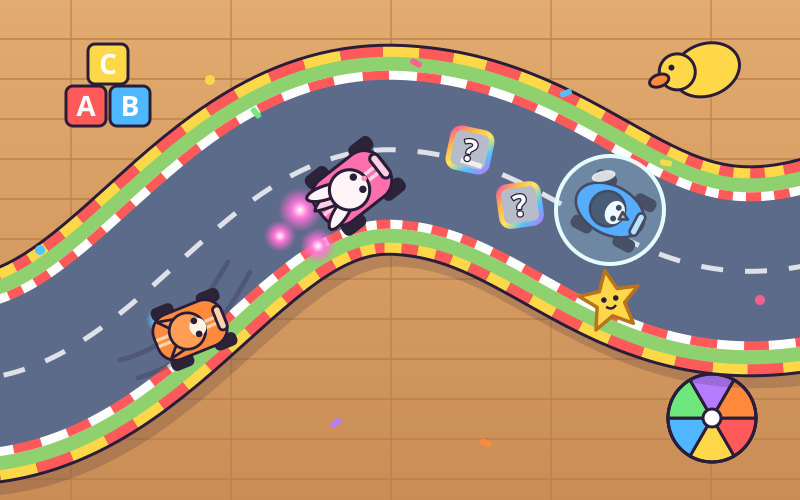</a><br><b><a href="games/pocket-kart/">Pocket Kart</a></b><br><sub>Drift, bounce and zoom with your critter crew!</sub></td>
</tr>
</table>

### 🧩 Puzzle & Word

<table>
<tr>
<td align="center" valign="top" width="25%"><a href="games/jelly-jam/">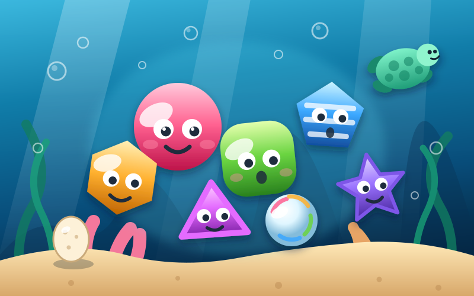</a><br><b><a href="games/jelly-jam/">Jelly Jam</a></b><br><sub>Squishy match-3. Free the reef's baby sea turtles.</sub></td>
<td align="center" valign="top" width="25%"><a href="games/letter-lagoon/">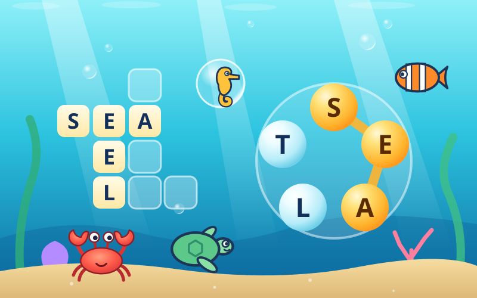</a><br><b><a href="games/letter-lagoon/">Letter Lagoon</a></b><br><sub>Spell words. Pop bubbles. Free the sea critters.</sub></td>
<td align="center" valign="top" width="25%"><a href="games/riverlight/">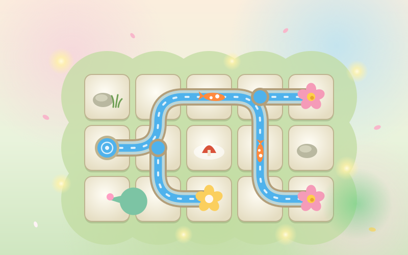</a><br><b><a href="games/riverlight/">Riverlight</a></b><br><sub>Turn the stones. Guide the glowing stream.</sub></td>
<td align="center" valign="top" width="25%"><a href="games/tiny-trains/">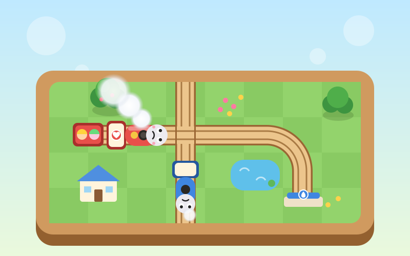</a><br><b><a href="games/tiny-trains/">Tiny Trains</a></b><br><sub>Lay toy track and get every train home.</sub></td>
</tr>
<tr>
<td align="center" valign="top" width="25%"><a href="games/robo-route/">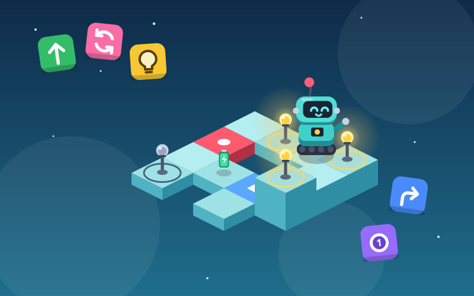</a><br><b><a href="games/robo-route/">Robo Route</a></b><br><sub>Program Bolt the robot with loops and colour tiles.</sub></td>
<td align="center" valign="top" width="25%"><a href="games/spooky-spotter/">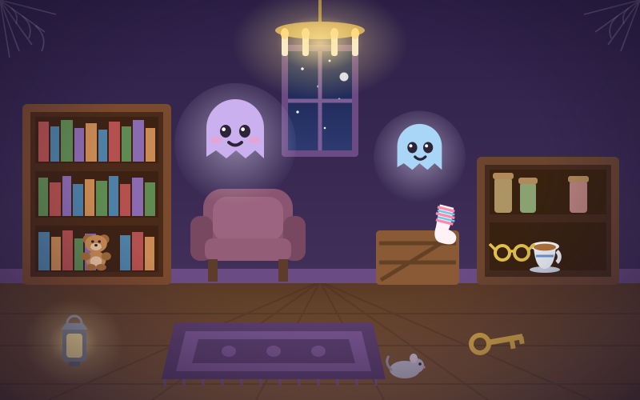</a><br><b><a href="games/spooky-spotter/">Spooky Spotter</a></b><br><sub>Find the shy ghosts' lost things in seven rooms.</sub></td>
<td align="center" valign="top" width="25%"><a href="games/bubble-bay/">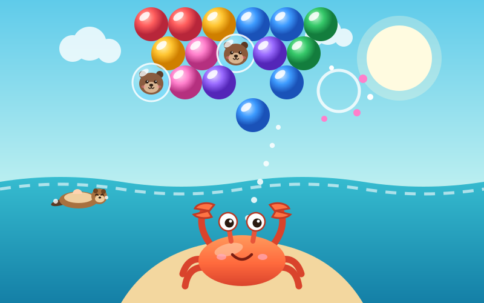</a><br><b><a href="games/bubble-bay/">Bubble Bay</a></b><br><sub>Pop seaside bubbles and rescue baby otters.</sub></td>
<td align="center" valign="top" width="25%"><a href="games/keyboard-knights/">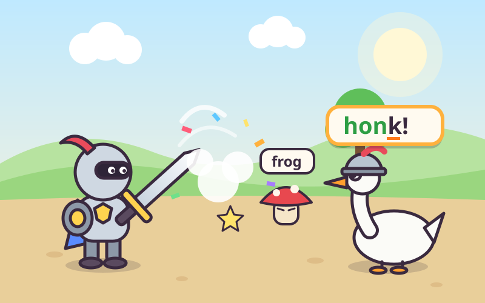</a><br><b><a href="games/keyboard-knights/">Keyboard Knights</a></b><br><sub>Type the words. Swing the sword. Poof the monsters!</sub></td>
</tr>
<tr>
<td align="center" valign="top" width="25%"><a href="games/picto-paint/">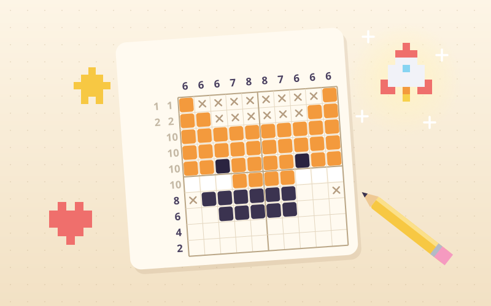</a><br><b><a href="games/picto-paint/">Picto Paint</a></b><br><sub>Solve number clues to paint pictures that come alive.</sub></td>
<td align="center" valign="top" width="25%"><a href="games/clue-critters/">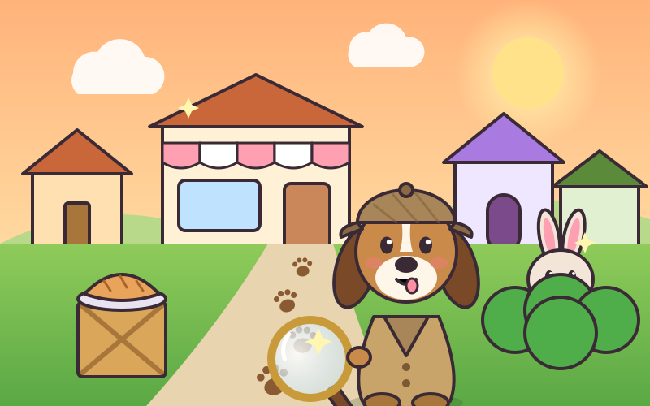</a><br><b><a href="games/clue-critters/">Clue Critters</a></b><br><sub>Sniff out clues and solve cozy village mysteries!</sub></td>
<td align="center" valign="top" width="25%"><a href="games/comet-courier/">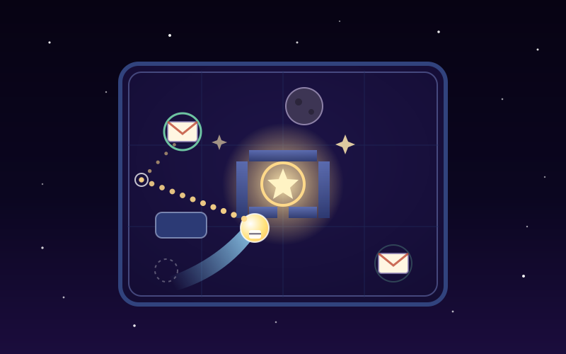</a><br><b><a href="games/comet-courier/">Comet Courier</a></b><br><sub>Sweep up the mail, then sink it in the star.</sub></td>
</tr>
</table>

### 🕹️ Arcade & Party

<table>
<tr>
<td align="center" valign="top" width="25%"><a href="games/comet-crush/">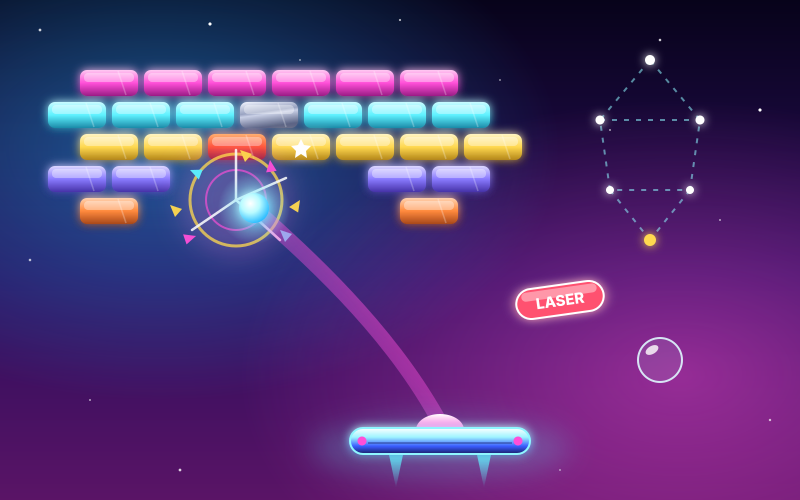</a><br><b><a href="games/comet-crush/">Comet Crush</a></b><br><sub>Smash crystal bricks. Save the constellations.</sub></td>
<td align="center" valign="top" width="25%"><a href="games/pinball-planet/">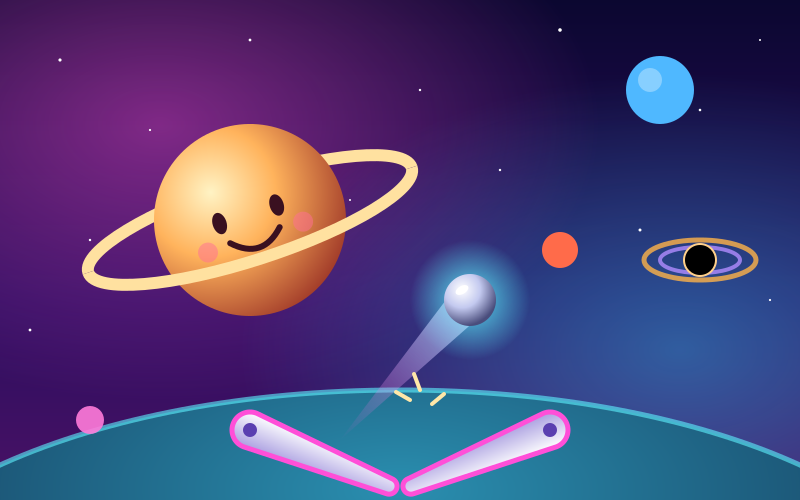</a><br><b><a href="games/pinball-planet/">Pinball Planet</a></b><br><sub>Flip, orbit and nudge across the galaxy.</sub></td>
<td align="center" valign="top" width="25%"><a href="games/groove-garden/">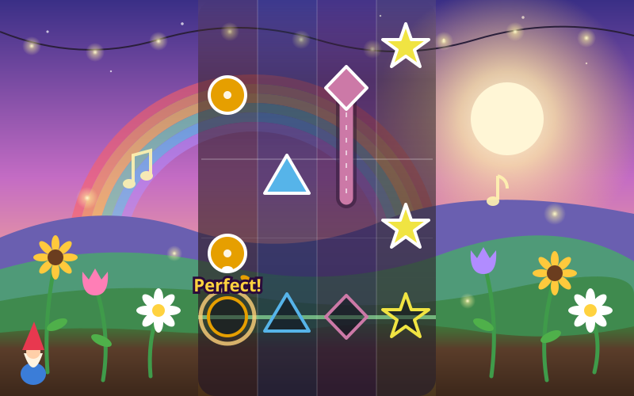</a><br><b><a href="games/groove-garden/">Groove Garden</a></b><br><sub>Tap to the beat and watch your garden bloom.</sub></td>
<td align="center" valign="top" width="25%"><a href="games/bumper-blobs/">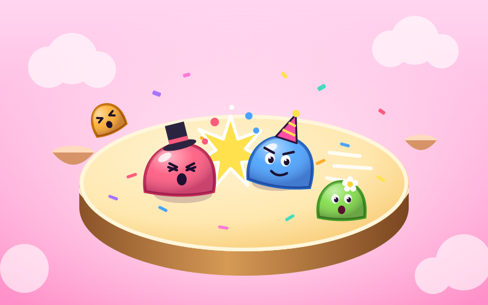</a><br><b><a href="games/bumper-blobs/">Bumper Blobs</a></b><br><sub>Squishy sumo for 1–4 players. Bump them off!</sub></td>
</tr>
<tr>
<td align="center" valign="top" width="25%"><a href="games/snack-siege/">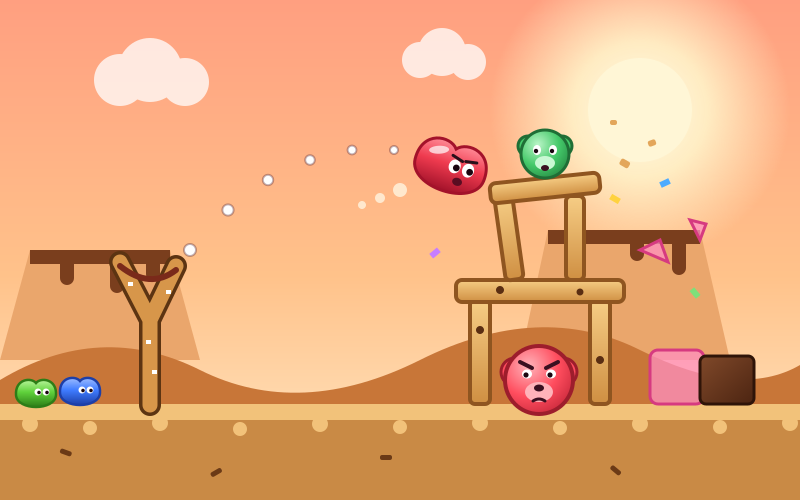</a><br><b><a href="games/snack-siege/">Snack Siege</a></b><br><sub>Fling jelly beans. Topple candy forts.</sub></td>
<td align="center" valign="top" width="25%"><a href="games/snowball-summit/">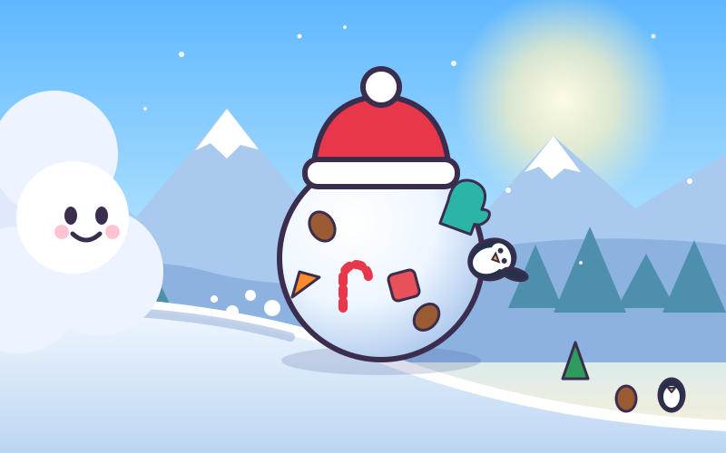</a><br><b><a href="games/snowball-summit/">Snowball Summit</a></b><br><sub>Roll a snowball downhill and grow it giant.</sub></td>
<td align="center" valign="top" width="25%"><a href="games/tumble-tower/">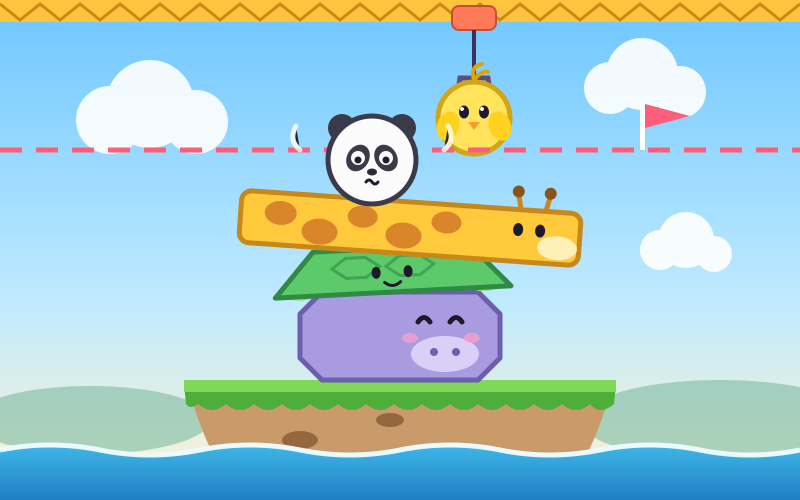</a><br><b><a href="games/tumble-tower/">Tumble Tower</a></b><br><sub>Stack wobbly animals up to the goal line!</sub></td>
<td align="center" valign="top" width="25%"><a href="games/paper-plane-post/">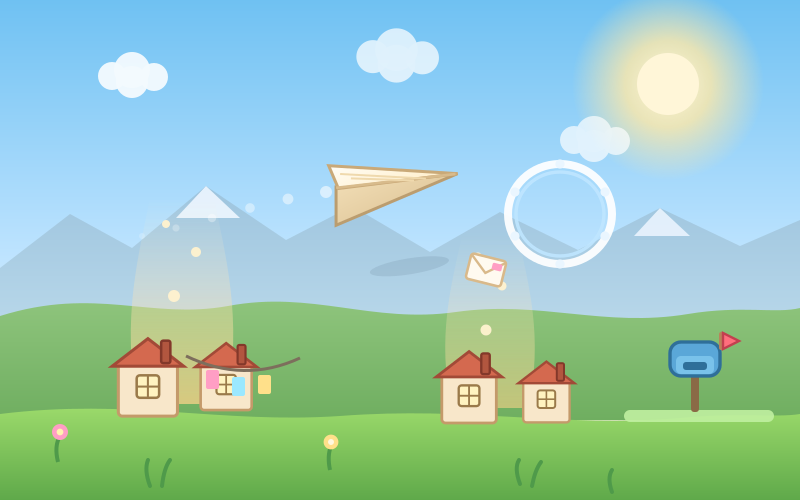</a><br><b><a href="games/paper-plane-post/">Paper Plane Post</a></b><br><sub>Hold to dive, let go to soar. Deliver the post.</sub></td>
</tr>
<tr>
<td align="center" valign="top" width="25%"><a href="games/shard-storm/">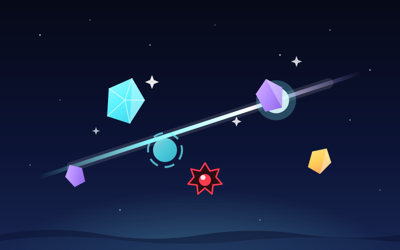</a><br><b><a href="games/shard-storm/">Shard Storm</a></b><br><sub>Swipe the blade. Hold back the surge.</sub></td>
</tr>
</table>

### 🍵 Cozy

<table>
<tr>
<td align="center" valign="top" width="25%"><a href="games/glowloop/">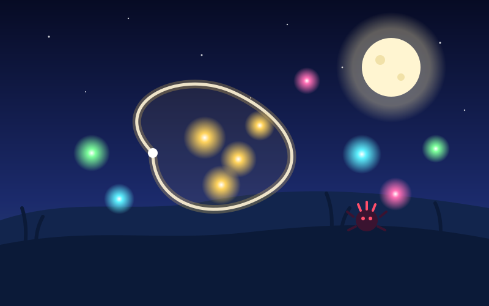</a><br><b><a href="games/glowloop/">Glowloop</a></b><br><sub>Lasso the fireflies. Light up the night.</sub></td>
<td align="center" valign="top" width="25%"><a href="games/sprout-valley/">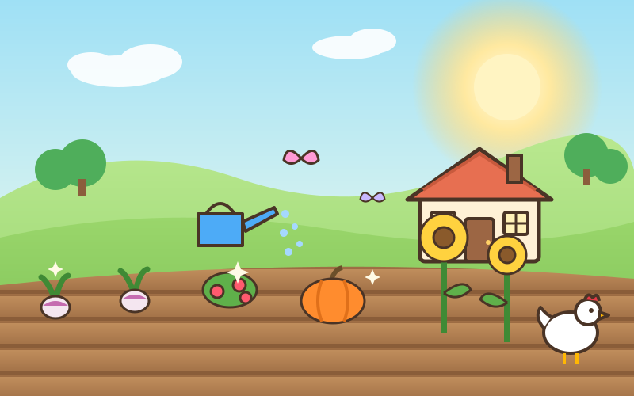</a><br><b><a href="games/sprout-valley/">Sprout Valley</a></b><br><sub>A cozy farm life: grow, befriend, celebrate.</sub></td>
<td align="center" valign="top" width="25%"><a href="games/pocket-zoo/">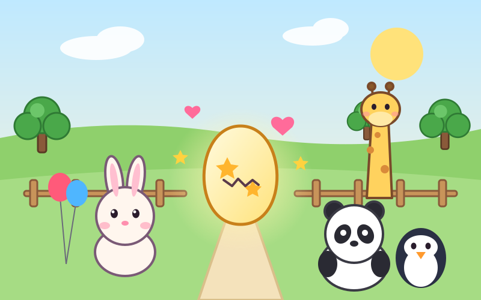</a><br><b><a href="games/pocket-zoo/">Pocket Zoo</a></b><br><sub>Hatch mystery eggs. Build the coziest zoo.</sub></td>
<td align="center" valign="top" width="25%"><a href="games/potion-pals/">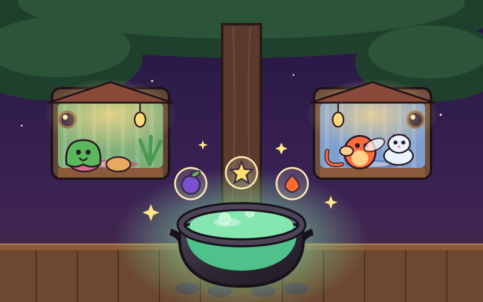</a><br><b><a href="games/potion-pals/">Potion Pals</a></b><br><sub>Mix anything. Discover everything. Collect pals.</sub></td>
</tr>
<tr>
<td align="center" valign="top" width="25%"><a href="games/pixel-pond/">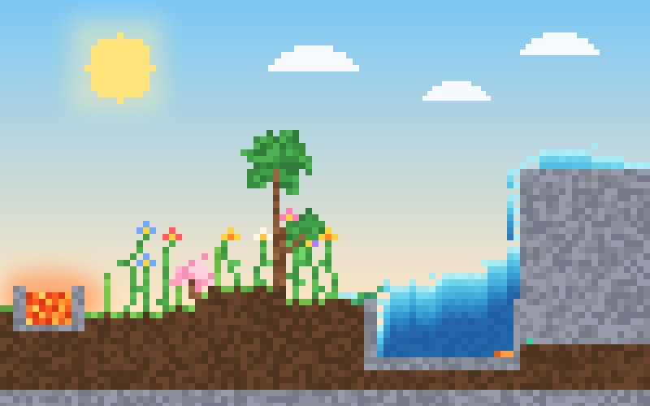</a><br><b><a href="games/pixel-pond/">Pixel Pond</a></b><br><sub>Paint a falling-sand garden that grows by itself.</sub></td>
<td align="center" valign="top" width="25%"><a href="games/campfire-solitaire/">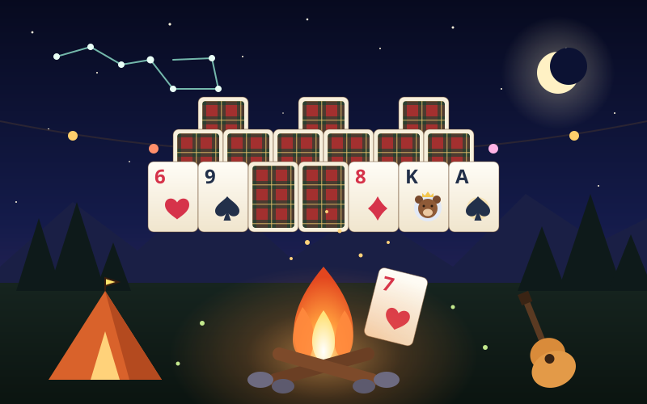</a><br><b><a href="games/campfire-solitaire/">Campfire Solitaire</a></b><br><sub>Cozy solitaire under the stars. One up, one down.</sub></td>
</tr>
</table>

### 🏆 Strategy & Sports

<table>
<tr>
<td align="center" valign="top" width="25%"><a href="games/garden-guardians/">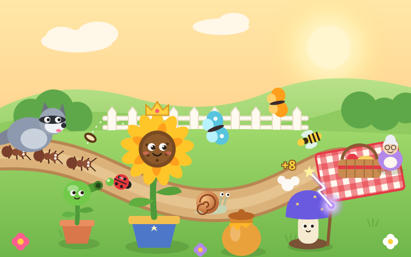</a><br><b><a href="games/garden-guardians/">Garden Guardians</a></b><br><sub>Plant defenders. Shoo the bug parade. Save the picnic.</sub></td>
<td align="center" valign="top" width="25%"><a href="games/moonshot-golf/">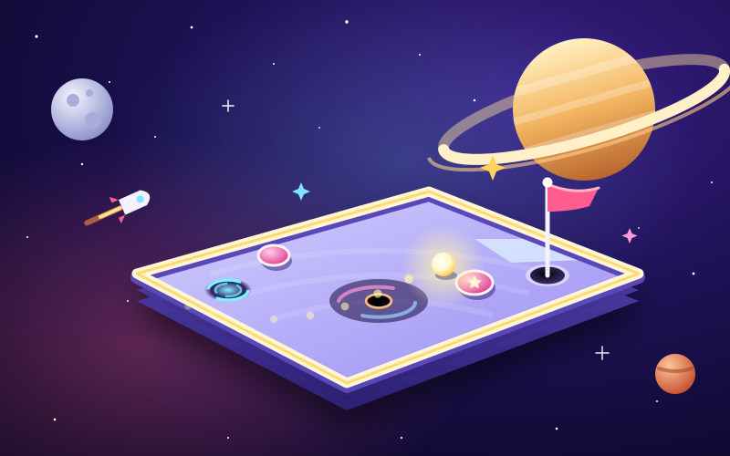</a><br><b><a href="games/moonshot-golf/">Moonshot Mini Golf</a></b><br><sub>Cartoon mini golf across the solar system.</sub></td>
<td align="center" valign="top" width="25%"><a href="games/knight-shift/">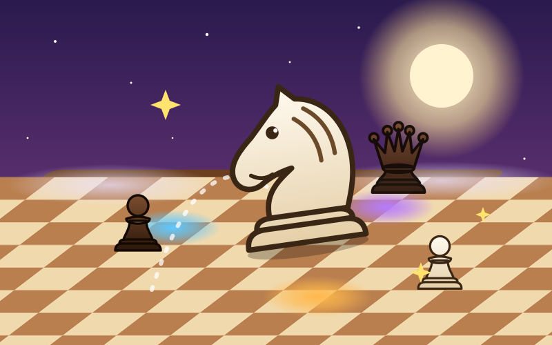</a><br><b><a href="games/knight-shift/">Knight Shift</a></b><br><sub>Chess with a twist, for everyone.</sub></td>
<td align="center" valign="top" width="25%"><a href="games/reel-rumble/">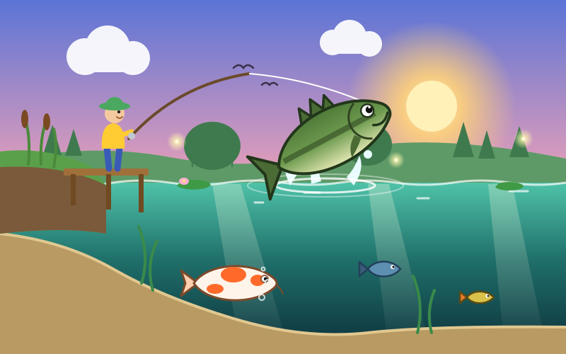</a><br><b><a href="games/reel-rumble/">Reel Rumble</a></b><br><sub>Cast, hook and reel in 50 fish across five waters.</sub></td>
</tr>
<tr>
<td align="center" valign="top" width="25%"><a href="games/bakery-blitz/">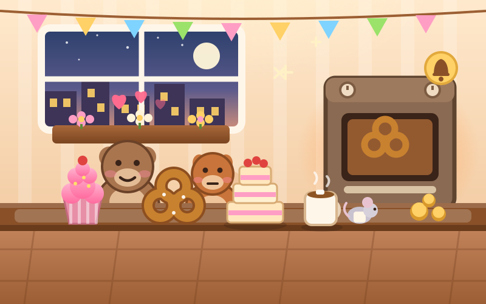</a><br><b><a href="games/bakery-blitz/">Bakery Blitz</a></b><br><sub>Mix, bake, decorate, serve. Nobody ever yells.</sub></td>
<td align="center" valign="top" width="25%"><a href="games/hoop-heroes/">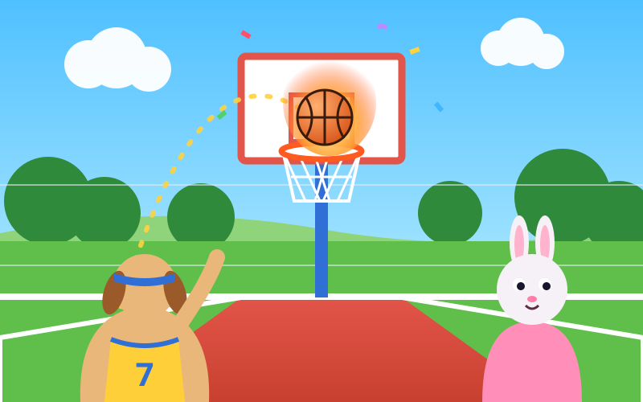</a><br><b><a href="games/hoop-heroes/">Hoop Heroes</a></b><br><sub>Flick it, swish it, beat the animal all-stars!</sub></td>
<td align="center" valign="top" width="25%"><a href="games/tiny-kingdoms/">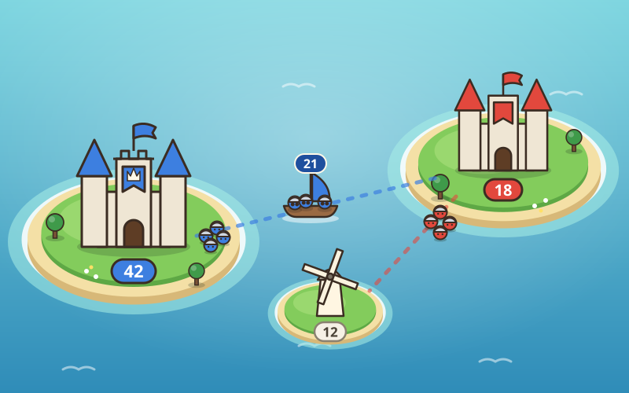</a><br><b><a href="games/tiny-kingdoms/">Tiny Kingdoms</a></b><br><sub>March little soldiers across storybook islands.</sub></td>
</tr>
</table>

<!-- cabinets:end -->

## 🦊 Meet the regulars

A few of the faces you'll run into around the boardwalk:

| | Who | Where |
| :-: | --- | --- |
| 🌱 | **Pip**, a little sprout with a long climb to the sunrise | Pip's Peak |
| 🦊 | **Tumble**, the fox at the young lamplighter's heels | Lanternwood |
| 👵 | **Grandma Wick**, waiting in Lantern Plaza by the Great Lantern | Lanternwood |
| ⛏️ | **Momo**, a mole in a drill pod, digging for the Ancient Core | Mole Miner |
| 🤖 | **Bolt**, a cheerful robot who bonks, sparks and shrugs, but never sulks | Robo Route |
| 🐶 | **Ace**, a puppy in a bright jersey who now has to actually aim | Hoop Heroes |
| 🐱 | **Mittens**, a kitten who has gone missing (it's always Mittens) | Clue Critters |
| ☄️ | **Penny**, the comet who delivers the mail by starlight | Comet Courier |
| 🏎️ | **Bun, Fen, Bo, Mimi, Toto** and the rest of the critter crew | Pocket Kart |
| 🦍 | **KONG-TRON 2600**, a boss who has learned that standing still is not a strategy | Jungle Blaster 2600 |

## 🌟 Psst…

<details>
<summary>🕹️ The sign out front has a secret. Click for a hint.</summary>

<br>

The marquee still remembers an old cabinet code:
<kbd>↑</kbd> <kbd>↑</kbd> <kbd>↓</kbd> <kbd>↓</kbd> <kbd>←</kbd> <kbd>→</kbd> <kbd>←</kbd> <kbd>→</kbd> <kbd>B</kbd> <kbd>A</kbd>

No keyboard? Give the spinning coin on the sign a few quick taps.

What the sign says next is between you and the sign.

</details>

Most cabinets can also play themselves. Add `?autoplay` or `?autopilot` to a
game's address (its README says which) and the demo bot takes the controls,
which is handy for watching how a level is meant to go. Demo runs never touch
your save.

## 🔧 Behind the counter

### Layout

```
index.html          Starlight Arcade, the game picker
arcade/             arcade styles, script, game manifest (games.js), shelves (logic.js) and tests
games/
  <slug>/           one self-contained game per folder
    index.html      entry point, opens directly or from the arcade
    cover.svg       800×500 card art shown in the arcade (and in the gallery above)
    README.md       how to play
    tests/          node:test unit tests (*.test.js)
scripts/            the dev server, the telemetry sync and the README gallery builder
docs/               the new-game brief, the play-test brief, the launch checklist and design notes
```

### Adding a game

Follow [`docs/new-game-brief.md`](docs/new-game-brief.md): a folder with a
`cover.svg`, arcade links, the shared `telemetry.js` and `fullscreen.js`, then
an entry in `arcade/games.js` with a genre that maps to one of the arcade's
shelves. Run `npm run readme` to add its cabinet to the gallery above. The
tests check that every folder is in the manifest and that the gallery matches
it.

### Conventions

- **No build step, no npm dependencies.** Games are plain HTML/CSS/JS. Simple
  games work opened straight from disk; games that use ES modules (like the 3D
  ones) need `npm run serve`.
- **Self-contained games.** A game only references files inside its own folder
  (libraries are vendored there, e.g. `games/sundown-rally/vendor/three`), so
  games can be added, moved, or removed without affecting each other.
- **Namespaced storage.** All games share one origin when served together, so
  prefix `localStorage` keys with the game slug (for example `glowloop.v1`).
- **Testable rules.** Keep pure game logic in DOM-free files that Node tests
  can import.
- **Hide the pointer while playing.** Games hide the mouse pointer after a
  moment without movement during play, and show it again on any movement.

### Full screen

Every page loads `fullscreen.js`. Move the pointer to the top edge and a pill
slides in: **Full screen**, or **Exit full screen (Esc)** while in full screen.
Page-level full screen hides the browser toolbar, so the address bar no longer
drops down when the mouse nears the top. The browser always keeps Esc as a way
out.

Turning it on is remembered (`arcade.v1.fullscreen`). Browsers end full screen
on every page change and only allow entering it from a click or key press, so
the next click or key press on any arcade page re-enters it. Leaving with Esc
or the pill turns it off until you turn it on again; changing pages never
does. Where the Fullscreen API isn't available (iPhone Safari), the pill never
appears.

### Telemetry and support

Every game and the arcade load `telemetry.js` first (`<script src="telemetry.js"
data-service="<slug>">`). It writes structured logs that follow the
OpenTelemetry Logs data model (severity, body, attributes, trace and span IDs,
`service.name`, `session.id`) and uses the exception semantic conventions for
errors.

- **Crash screen.** An uncaught error, or one inside a loop wrapped with
  `Telemetry.guard(fn)`, shows "Oops! The game hit a bug." with *Try again*,
  *Back to arcade* and *Copy report*, instead of a frozen picture.
- **Local logs.** The last 200 records per game are kept in `localStorage`
  under `<slug>.v1.log`. Nothing leaves the device by default.
- **Help & diagnostics.** The arcade footer opens a panel that summarizes
  problems per game, copies one support report for all games, clears logs,
  and switches sending on or off.
- **OTLP export.** With sending on (or `?otlp=<url>`, or `?otlp=same`), games
  POST OTLP/HTTP JSON to `<url>/v1/logs`. A link's `?otlp=` can only point at
  the site itself or a local collector (`localhost`, `127.0.0.1`), so a shared
  link can't start sending a visitor's logs elsewhere; any other server has to
  be entered in Help & diagnostics. `npm run serve` accepts these at
  `http://localhost:8000/v1/logs`, appends them to `logs/telemetry.ndjson`
  (git-ignored) and prints warnings and errors. Any OpenTelemetry Collector
  with an OTLP/HTTP receiver (port 4318, CORS allowed for the arcade's origin)
  works too.
- **Game events.** Use `window.Telemetry?.log.event(name, attributes)`.
  Neon Nighthawk also reports slow frames (`frame.long`, `perf.degraded`) and
  freezes (`frame.stall`, measured by a watchdog outside the frame loop).

`arcade/telemetry.js` is the canonical copy. After editing it, run
`npm run sync-telemetry`; the arcade tests check every copy matches.

### Going live

Zarcade is live on GitHub Pages at
<https://jpvelasco.github.io/zarcade/>, deployed from the `main` branch. Every
link is relative, so the arcade and its games work from that sub-path. The
remaining launch steps (the repo's social preview image and checks on real
devices) are tracked in [`docs/launch-checklist.md`](docs/launch-checklist.md).

### License

Zarcade is released under the [MIT License](LICENSE). The copies of
[three.js](https://threejs.org/) vendored in `games/*/vendor/three/` keep
their own MIT license alongside them.

### Commands

```sh
npm test               # run every game's tests, plus the arcade and telemetry tests
npm run serve          # serve the repo at http://localhost:8000 (no caching) and collect OTLP logs
npm run sync-telemetry # copy arcade/telemetry.js and fullscreen.js into every game
npm run readme         # rebuild the cabinet gallery in this README from arcade/games.js
```


---

```text
                    ★  HIGH SCORES  ★

            1ST   YOU ..................  999,999
            2ND   ACE ..................   88,800
            3RD   BOLT .................   12,450
            4TH   KONG-TRON 2600 .......        0   (stood still)

                 THANKS FOR PLAYING · PRESS START
```
